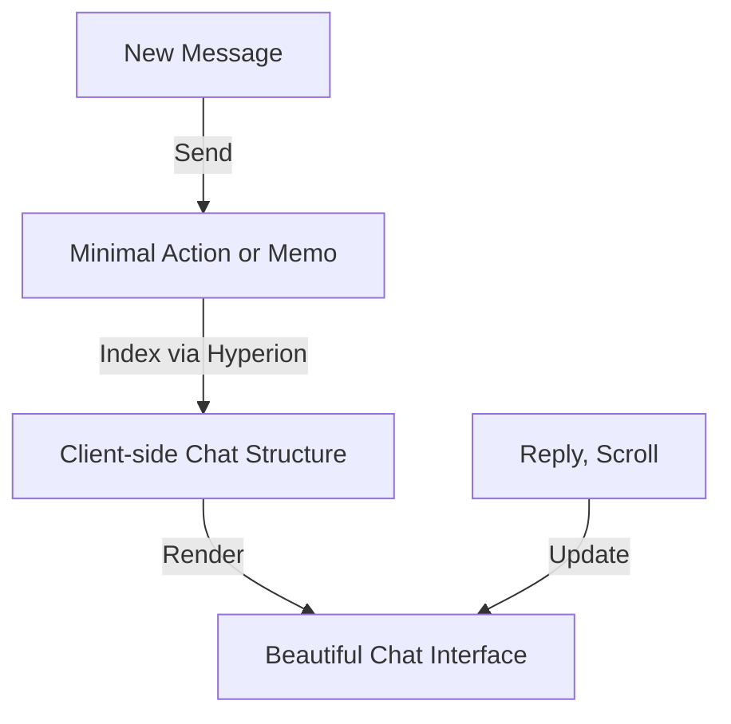

# wax-null-action-chat — Lightweight On-Chain Null-Action Chat

> **Status:** 🔒 Private (In Development) | Target Public Release: August 2026  
> **Category:** P2P Social & On-Chain Messaging  
> **Parent Catalog:** [pixel-journey/wax-ecosystem-blueprint-catalog](https://github.com/pixel-journey/wax-ecosystem-blueprint-catalog)

**One-sentence goal:** A lightweight, real-time chat system using minimal on-chain actions (null actions or small memos) for instant messaging between wallets, with beautiful UI and full provenance on WAX.

---

## 1. Overview & Goal

This blueprint brings simple, low-cost, on-chain chat to WAX. Users can message each other with minimal on-chain footprint and beautiful UX.

- **Why it matters for WAX:** Real-time social and coordination are essential. Low-cost on-chain chat enables seamless P2P communication with ownership.
- **Public infrastructure only:** Minimal actions or memos via standard WAX transactions, Hyperion for message history, client-side rendering. No custom contracts.
- **Target users:** Traders, community members, P2P coordinators, anyone wanting lightweight on-chain chat.
- **Success metrics:** "Send and receive messages in <2s with beautiful UI", "Full on-chain provenance and history", "Low-cost, reliable messaging".

---

## 2. Concepts & Inspiration

- **Core concepts:** Messages are sent as small on-chain actions or memos. Client indexes via Hyperion and renders as familiar chat UI with threads or direct messages.
- **Pain points:** Most chat is centralized. On-chain versions can be expensive or clunky without optimization.
- **Inspirations:** Telegram/Discord UX, on-chain messaging experiments, lightweight blockchain chat. Web3: owned messages with minimal cost.
- **Cross-references:** Perfect with `wax-decentralized-microblogging`, `wax-null-action-chat` complements P2P social and storytelling tools.

---

## 3. Design Specifications (Pixel Journey Standards)

### 3.1 Visual & Interaction Design
- Clean, modern chat interface with elegant bubbles and timestamps.
- Main view: Direct message or group chat with smooth scrolling.
- Controls: Message input, send button, emoji/reactions (local or on-chain), history scroll.
- Micro-interactions: Smooth message animations, typing indicators, read receipts (local or on-chain).
- Responsive: Excellent on desktop; touch-friendly mobile chat.

### 3.2 Key Views / Components
- `NullActionChat.tsx` — Main chat interface.
- `MessageBubble.tsx` — Beautiful message bubbles with provenance.
- `ChatInput.tsx` — Clean input with send and emoji.
- `ThreadView.tsx` — Optional threaded conversations.
- `HistoryLoader.tsx` — Efficient loading of older messages.

### 3.3 Accessibility (A11y) & Inclusive Design
- WCAG 2.2 AA: Keyboard navigation, screen reader support for messages, high contrast.
- Clear structure for conversations.
- Option for linear or threaded view.

### 3.4 Performance & Optimization Targets
- Efficient message indexing and rendering.
- Fast send and receive with optimistic UI.
- Smooth scrolling even with long histories.

---

## 4. Technical Architecture

### 4.1 Core Tech Stack
- Next.js 15 + TypeScript + Tailwind + shadcn/ui
- @tanstack/react-query for message history
- Hyperion for action/memo indexing
- Simple client-side message grouping
- Minimal on-chain action or memo sending via WharfKit

### 4.2 Data Flow Diagram


### 4.3 Folder Structure
```
app/
├── (chat)/[peer]/page.tsx
├── components/
│   ├── chat/
│   │   ├── NullActionChat.tsx
│   │   └── MessageBubble.tsx
│   └── input/
│       └── ChatInput.tsx
├── hooks/useNullActionChat.ts
├── lib/wax/
│   ├── message-indexer.ts
│   └── chat-utils.ts
└── types/chat.ts
```

### 4.4 Security & Privacy
- Messages are public and on-chain. Optional local reactions.
- Clear provenance for every message.

---

## 5. Implementation Examples & Code Snippets

**Core chat hook**
```ts
// hooks/useNullActionChat.ts
export function useNullActionChat(peer: string) {
  return useQuery({
    queryKey: ['chat', peer],
    queryFn: async () => {
      const messages = await fetchMessages(peer);
      return groupMessages(messages);
    }
  });
}
```

**Message sending**
```ts
async function sendMessage(text: string, signAction: Function) {
  await signAction({ action: 'chat', data: { text, to: peer, timestamp: Date.now() } });
}
```

---

## 6. Demo & Testing
- Demo mode with sample conversations.
- Live mode with real on-chain messages.
- Interaction tests: send, receive, scroll, reply.
- Performance tests for long histories.

---

## 7. Roadmap
Phases: Message indexing and chat data layer → Core chat UI → Polish, a11y, threading → full documentation.

Future: Group chats, rich media, integration with microblogging and wallet profiles.

---

## 8. Visual References
> Clean chat UIs like Telegram or Discord, but with Web3 ownership and minimal on-chain footprint. Elegant bubbles, smooth interactions, clear provenance. Reference: high-quality chat web UIs.

---

## 9. Related Blueprints
- `wax-decentralized-microblogging` — Complementary social layer.
- Other P2P social and messaging blueprints.

---

## 10. License & Credits
MIT. Built for lightweight on-chain chat on WAX.

**Pixel Journey — Beautiful interfaces for public blockchain data.**
